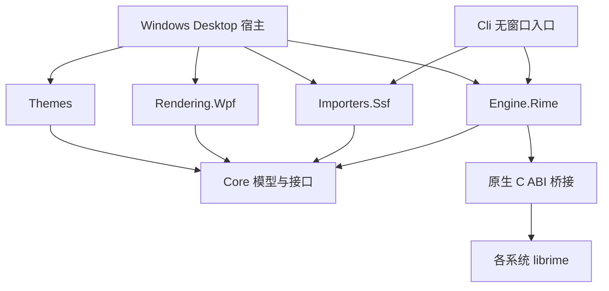

# 跨平台与组件化方案

日期：2026-11-06。

结论：TypeFlow 可以沿用现有 C# + Rime 做跨平台。共享皮肤、导入、候选模型、布局编辑事务和引擎协议；界面渲染和系统输入法接入分别适配。当前完成共享组件拆分及原生桥接的平台加载隔离，完整三平台输入法仍需分阶段实现。

## 已落地的组件边界

| 工程 | 职责 | 平台依赖 |
| --- | --- | --- |
| TypeFlow.Core | 皮肤模型/校验、候选数据、导入器/引擎/渲染/校验接口 | .NET 10 |
| TypeFlow.Themes | 皮肤库、配置关联/重载、布局编辑事务、撤销/重做和副本保存 | .NET 10；宿主注入导入器、图片校验器和转码器 |
| TypeFlow.Importers.Ssf | SSF 解析、原生格式转换、兼容性报告 | .NET 10 |
| TypeFlow.Engine.Rime | IInputEngine 的 Rime 实现，通过 C ABI 调用桥接 | .NET 10 + 对应系统/架构的原生库 |
| native | 动态加载 librime，输出候选与上屏数据 | C++17；Windows loader 或 POSIX loader |
| TypeFlow.Rendering.Wpf | WPF 候选渲染、图片解码、画布命中信息和图片校验 | Windows |
| TypeFlow.Desktop | 输入实验室、编辑窗口、WPF 事件、Windows 宿主与实现装配 | Windows |
| TypeFlow.Cli | 无窗口导入、模型校验、真实引擎冒烟入口 | .NET 10；引擎命令另需原生库 |



依赖方向固定为宿主选择组件、组件依赖共享契约。Core、Themes、导入器和引擎适配不引用 Desktop 或 WPF。不要通过引用桌面可执行工程来复用皮肤管理。

### 可替换点

- IInputEngine：更换输入引擎不改皮肤管理；当前只实现 Rime。
- IThemeImporter + ImporterRegistry：显式注册导入器；Themes 不自动实例化 SSF。增加新格式时独立增加导入器。
- ICandidateRenderer：共享 Theme/CandidateView 输入；WPF 画布 Rect、图片对象和界面事件留在渲染工程。替代渲染器需另外实现各自的编辑/选择交互。
- IThemeValidator：宿主提供图片解码和渲染能力检查；关联配置通过校验后才发布快照。Windows 注入 WpfThemeValidator，维持原有坏图回退和九宫格检查。
- IThemeImageTranscoder：宿主校验图片并输出静态 PNG。共享编辑事务负责分配草稿路径、处理失败清理；Windows 通过 WpfThemeImageTranscoder 实现解码和 PNG 编码。
- DesktopComponents：Windows 可执行程序的装配入口，负责选择导入器和校验器。未来宿主各自装配，无需让共享服务了解平台。

组件化先使用工程和接口组合。皮肤包始终是数据；第三方可执行插件的动态发现、热卸载、沙箱和跨版本 ABI 还没有实现。没有为了模块化引入通用插件框架。

## 原生库与文件语义

托管层保持 DllImport("typeflow_rime") 的无扩展名名称，让 .NET 选择当前系统的库名：

| 系统 | 桥接产物 | librime 路径示例 |
| --- | --- | --- |
| Windows | typeflow_rime.dll | 自行提供的 rime.dll 完整路径 |
| Linux | libtypeflow_rime.so | 自行提供的 librime.so 或版本库完整路径 |
| macOS | libtypeflow_rime.dylib | 自行提供的 librime.dylib 完整路径 |

桥接与 librime 必须匹配进程架构，librime 的依赖也须可加载。Windows 的 DLL 和运行时压缩包不能当成 Linux/macOS 的运行时使用。当前 Prepare-Runtime.ps1 仍只准备 Windows 运行时。

操作系统加载差异集中在 native/dynamic_library.h；引擎业务和 JSON 协议共用。Windows 小狼毫通信测试仅在 Windows 构建。

库目录归属检查在 Windows 使用忽略大小写比较，其他系统使用严格比较，避免 Linux 上把仅大小写不同的兄弟目录视为自己的目录。皮肤资源名仍采用可移植的限制（包括 Windows 保留名），SSF 内部字段和资源匹配规则继续保持原兼容策略。外部配置关联记录含本机绝对路径，换设备/系统后需重新关联；分发时应导出独立原生皮肤。

## 界面和系统输入法分别推进

当前 WPF 只运行于 Windows。共享管理界面/编辑器的下一候选方案是 Avalonia；它可覆盖 Windows、Linux、macOS，并能继续使用 C#。本轮没有添加 Avalonia 依赖、安装环境或替换现有窗口。

开始迁移时先做单独小样：导入皮肤、显示同一 CandidateView、验证图片/字体/DPI/九宫格，再迁移配置页和编辑器。ThemeEditSession 已移入共享 Themes 工程；图片转码通过接口注入，移动操作只接收共享 TextPosition（DIP），不依赖 WPF Rect 或画布类型。撤销/重做、失败回滚、归属信息和原导入报告保留、独立副本发布都可由未来界面复用。现有编辑窗口及画布仍属于 Windows，尚未迁移到跨平台 UI。

系统输入接入建议保持薄适配：

| 系统 | 接入方向 | 需要独立验证 |
| --- | --- | --- |
| Windows | 现有小狼毫/TSF 复用入口 | 前端完整构建、注册、跨应用上屏、焦点、多屏定位 |
| Linux | Fcitx5 输入模块/宿主适配 | 组合与提交、按键语义、候选点击、X11/Wayland 会话差异 |
| macOS | InputMethodKit 原生宿主 | 会话生命周期、组合与提交、光标定位、候选窗与签名分发 |

跨平台管理窗口并不等于系统输入法已经跨平台。候选窗是否能做到跨平台统一渲染，需要验证各系统的焦点、坐标和窗口权限；尤其不能把 Windows 的浮窗和命名管道协议直接作为 Wayland 接入方式。第一阶段可以沿用平台默认候选 UI，优先完成真实输入闭环，再评估统一皮肤窗。

后续若共享后台跨进程服务，应另行定义版本化的会话/按键/提交/候选操作协议与身份校验；当前 CandidatePresentation 只是 Windows 候选展示数据，不是完整跨平台 IME 协议。暂不引入分布式服务或运行时插件市场。

## Rime 上游同步

已添加 upstream 指向官方 rime/librime，并将 master 上新增的 [2bae6b59](https://github.com/rime/librime/commit/2bae6b59) 合并到本地 master；合并提交为 7b51c077，无冲突。修复 installation.yaml 根节点类型异常时的恢复逻辑，保存同步目录/备份选项，并新增部署任务回归测试。TypeFlow 的三个原有提交保留。

该上游提交的 [Commit CI](https://github.com/rime/librime/actions/runs/42108823223) 和 [Release CI](https://github.com/rime/librime/actions/runs/42108822987) 检查全部通过。此次同步的是源码；sources.json 和当前使用的 Rime 1.17.0 预编译运行时仍固定于原版本，没有自动替换二进制或用户词库。

## 构建与验收

只构建共享组件和无窗口工具（需要已有 .NET 10；以下命令在仓库根目录执行）：

```powershell
pwsh -NoProfile -File typeflow/scripts/Build-Portable.ps1 -Test
# 有本机 C++17 编译器/CMake 时，同时构建原生桥接：
pwsh -NoProfile -File typeflow/scripts/Build-Portable.ps1 -Native -Test
```

没有 PowerShell 时可直接执行：

```sh
dotnet build typeflow/src/TypeFlow.Cli/TypeFlow.Cli.csproj -c Release -o typeflow/build/cli
dotnet run --project typeflow/tests/TypeFlow.Tests/TypeFlow.Tests.csproj -c Release -- .
cmake -S typeflow/native -B typeflow/build/native-portable -DCMAKE_BUILD_TYPE=Release
cmake --build typeflow/build/native-portable --config Release
ctest --test-dir typeflow/build/native-portable -C Release --output-on-failure
```

独立 CLI：

```sh
dotnet typeflow/build/cli/TypeFlow.Cli.dll --validate typeflow/themes/night/theme.json
dotnet typeflow/build/cli/TypeFlow.Cli.dll --import "test/ssf/尼古喵喵！.ssf" typeflow/build/my-portable-theme
```

导入目标须不存在。--validate 只检查模型和资源路径/大小，不解码图片，不保证实际渲染成功。完整 WPF 渲染校验仍由 Windows Desktop 的 --validate 提供。CLI 的 --engine-smoke 需要把本机桥接库放到 CLI 输出目录，并提供本机 librime、共享词库、独立用户目录和方案名；详见 --help。

### 本轮验证结果

| 检查 | 结果 |
| --- | --- |
| Windows Desktop / 共享组件 / CLI 编译 | 通过，0 警告、0 错误 |
| Windows CLI 独立运行 | 原生皮肤校验、真实 SSF 导入后校验通过；真实 Rime 输入 nihao 并返回上屏“你好” |
| Windows 核心、SSF、皮肤服务及共享编辑事务 | 当前工作区 59 项通过，包含新增的 22 项无窗口编辑检查 |
| Windows 真实 Rime、布局、配置重载、图片回退、候选协议 | 79 项集成检查通过，包含 26 项布局和 30 项配置检查 |
| Windows 原生加载/失败重试 | CTest 1/1 通过 |
| Debian GNU 14.2 原生桥接 | Release 编译通过 |
| Debian 原生加载/失败重试 | CTest 1/1 通过 |
| Linux C# 运行 | 7aa024f5 的 GitHub Ubuntu CI 编译/测试通过；本机 Debian 仍无 .NET，未新增环境 |
| Linux 真实 Rime 与系统输入 | 未验证；加载测试不包含真实词库或输入前端 |
| macOS 编译/运行/输入法 | 7aa024f5 的 GitHub macOS CI 编译/无窗口测试通过；GUI 与系统输入未实机验收 |
| 三系统 CI | 7aa024f5 的 Windows、Ubuntu、macOS 组件任务均通过；本轮后续改动尚未推送验证 |

已核实 7aa024f5 的 [Commit CI](https://github.com/MIK-HEAL/TypeFlow/actions/runs/42153417833)、[Release CI](https://github.com/MIK-HEAL/TypeFlow/actions/runs/42153417954) 和 [TypeFlow shared components](https://github.com/MIK-HEAL/TypeFlow/actions/runs/42153417363) 全部成功。远程通过范围是该提交；本地新增的 Rime 合并和共享编辑事务迁移需在推送后重新取得 CI 结果。

Windows 集成测试在沙箱中命名管道连接超时，沙箱外使用同一构建重跑后全部通过；测试只使用项目临时词库，不注册输入法。这些检查不替代桌面交互和系统级输入验收。

下一步顺序：共享组件的上一版三平台 CI 已通过，本轮先完成编辑事务解耦；之后做跨平台 UI 小样，再分别推进系统输入宿主。为 Linux 添加 .NET、引入新 UI 依赖或补齐 macOS 工具链前，先确认所需环境和依赖变更。

## 资料依据

- [WPF 平台范围](https://learn.microsoft.com/en-us/dotnet/desktop/wpf/overview)
- [.NET 原生库名称与加载规则](https://learn.microsoft.com/en-us/dotnet/standard/native-interop/native-library-loading)
- [Avalonia 支持平台](https://github.com/avaloniaui/avalonia-docs/blob/main/docs/supported-platforms.mdx)
- [Fcitx5 输入模块开发入口](https://fcitx-im.org/wiki/Develop_an_simple_input_method)
- [Apple InputMethodKit](https://developer.apple.com/documentation/inputmethodkit)
